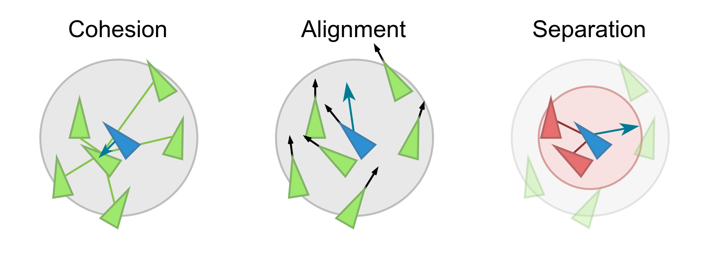
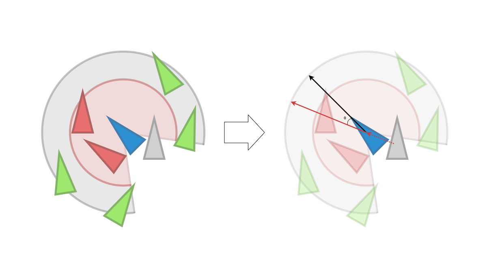
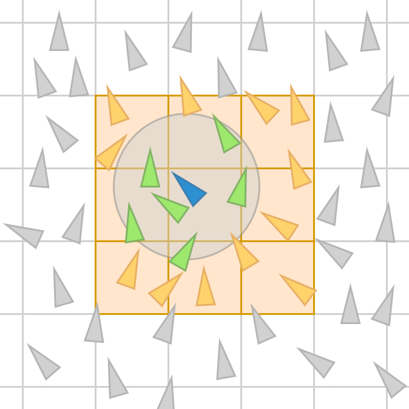
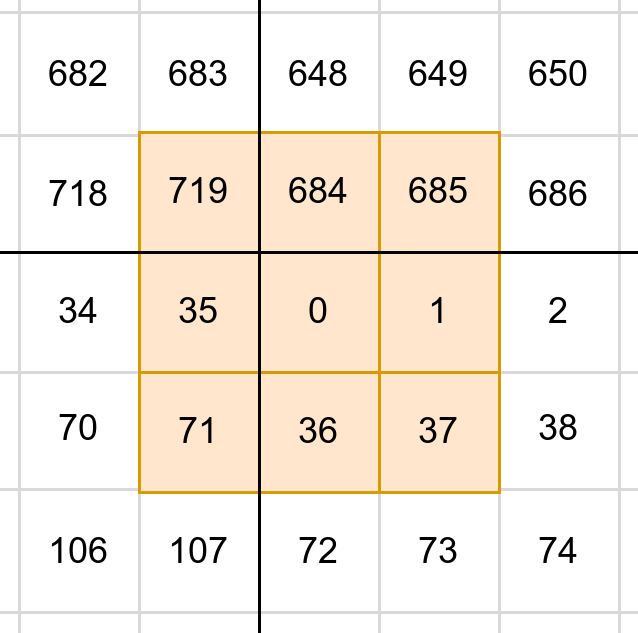

# Boids Simulation
*Boids* is a classic artificial life simulation in which collective flocking behaviour can emerge from the interaction of agents following simple rules. The Boids model consists of three rules: 

 - Cohesion : steer towards the average position of its neighbors, seeking to become part of the group
 - Alignment : follow the general direction of its neighbors
 - Separation : move away from agents that get too close, seeking to respect a "personal bubble" and avoid overcrowding (or collisions)

<p align="center" width="100%">
    
    <br>Figure 1 – The 3 fundamental rules<br>
</p>

This model was first implemented in 1986 by Craig Reynolds. More information can be found on Reynolds' [website](https://www.red3d.com/cwr/boids/).

An important aspect of this model is how agents evaluate their velocity depending on the behavior of local flockmates. When an agent evaluates its peers, it only considers a certain portion of the flock, i.e. agents within a certain radius (called *neighbors*). Thus, as they move, all boids will individually evaluate their own *neighborhood* and readjust their direction.

The evaluations for each boid are independent of each other and can therefore be computed simultaneously. A large population of agents can lead to a large amount of computation, so there is a huge advantage to using parallelism in the implementation of this simulation. The solution presented here exploits parallelism to simulate a population of boids that can reach hundreds of thousands using modern hardware.

# Getting started
Requirements: an NVIDIA GPU with a driver supporting CUDA 12, OpenGL 4.6, and Python 3.11 or newer (tested with 3.11 and 3.13). The CUDA toolkit is installed through pip, no system-wide installation is needed.

```
pip install -r requirements.txt
python boids.py
```

The rules can be tuned live with the sliders of the GUI. Press SPACE to hide the GUI and ESC to quit. The population, neighborhood radius and window size are set at the top of `boids.py`.

# Design

### Neighbor zone
An agent's neighbors are the flockmates within a certain radius around it. A smaller radius, set as a percentage of the neighbor radius, defines the "personal bubble" used by the separation rule. Each flockmate inside that bubble pushes the agent away, harder the closer it is: the push fades from full strength at contact to nothing at the edge of the bubble, and how quickly it fades can be tuned in the GUI (from the same push at any distance to a push felt only at very close range). Agents also have a blind spot: flockmates directly behind them are not considered, even if they are within the radius. The blind spot is a cone of about 37° on each side of the agent's back, so each agent perceives about 286° around itself.

<p align="center" width="100%">
    
    <br>Figure 2 – Neighbor zone : neighbors (green), flockmates within the separation radius (red) and a flockmate in the blind spot (grey), which is ignored<br>
</p>

### Randomness
Without randomness, the flock quickly settles into very orderly, parallel streams. Two kinds of random steering can be added in the GUI, weighted like the three rules:

 - Jitter : a new random push every frame, independent of the previous ones (Gaussian, so small pushes are the most likely). Agents tremble or wobble along their path. Pushes against an agent's direction also slow it down a little.
 - Wander : Craig Reynolds' *wander* steering behavior. Each agent steers towards a target on a small circle ahead of it, and the target drifts a little around the circle every frame. Since the circle is ahead, the target is never more than 30° off the agent's direction, and since it drifts slowly and moves with the agent, the agent keeps turning the same way for a while before changing its course. Agents follow smooth, meandering curves. The *wander rate* sets how fast the target drifts.

Both are applied in steps of 1/60 s, so they behave the same way whatever the frame rate.

### Wrap-Around
The simulation features a *wrap-around* mechanism, which consists of connecting the opposite edges of the grid in order to be able to loop infinitely through the simulated space. On a wrap-around grid, an agent reaching the right boundary would appear on the left side, and if it would reach the lower boundary, it would reappear at the top of the grid. The space of the simulation thus has a toroidal topology. This feature is optional but has some impact on the implementation, namely when it comes to calculating the distance between two agents.

# Implementation
One of the main steps in computing the direction of boids is the *neighbor search*, i.e. when an agent must evaluate which of its peers are its neighbors. A naive implementation would involve considering each peer one by one and calculating the distance between each other to determine if they are within the neighborhood radius, which results in a time complexity of O(n<sup>2</sup>). With a large population, this implementation would prove inefficient, even with parallelization.

### Spatial Partitioning
One solution to this problem is to use spatial partitioning. The simulation space is thus divided into cells distributed on a grid. This grid is used to identify the position of each agent and associate them to a certain cell. The size of the cells is determined in accordance with the radius of the boids' neighborhood area. The neighbors of an agent will therefore always be found within the block of 9 cells at the center of which the agent is located. This technique significantly reduces the average time required for the neighbor search and also gives a new opportunity to exploit space as a data structure.

<p align="center" width="100%">
    
    <br>Figure 3 – Spatial partitioning : agents only consider flockmates that are positioned in the adjacent cells to evaluate which of them are their neighbors<br>
</p>

### Neighbor search
Using a partitioned grid, an agent will look for neighbors in 9 cells, i.e. its current cell and the 8 other cells surrounding it. As shown in Figure 4 below, a cell can also have adjacent cells over the edge of the grid when using wrapped geometry.

<p align="center" width="100%">
    
    <br>Figure 4 – Wrap-around edges on the spatial partitioning grid (using a 36 x 18 grid in this example)<br>
</p>

When searching for neighbors, an agent will thus search in specific cells depending on which one it is on. Instead of constantly performing operations to find the indexes of the neighboring cells, a lookup table can be created at the beginning of the simulation and consulted by the agents, thus saving precious computation time. After identifying the neighboring cells, an agent must then evaluate which of its peers are in those cells. To do so, every frame, the agents are sorted by cell and their data (position and direction) is copied in that order. The agents of a same cell are then contiguous in memory, and two other tables give the index where each cell starts and ends. The candidates of a cell can thus be read one after the other, without jumping around in memory. Then, the agent must determine if these candidates are actual neighbors by measuring the distance between the two of them. Once all the candidates of the 9 cells have been evaluated, the three rules are applied to all of the agent's neighbors at once and the agent adapts its trajectory to the data collected from its neighborhood.

### Candidate sampling
The cost of the neighbor search grows with the density of the flock: when a lot of agents gather in the same area, each of them has thousands of candidates to evaluate. To keep the simulation fast, the number of candidates evaluated by an agent is capped (the *candidate budget*, set at the top of `boids.py`). When the 9 cells hold more candidates than the budget, only one candidate out of every few is evaluated, starting from a random position that changes every frame. Every candidate thus has the same chance of being evaluated, whatever its cell or direction, and an agent's neighbors are still represented from all sides.

Alignment and cohesion are barely affected by this sampling, since they depend on the average direction and position of many neighbors. Separation is more sensitive, since it depends on the few agents that are very close: in dense clumps, it becomes noisier and weaker, and agents may overlap a bit more. Agents with fewer candidates than the budget are not affected at all.

### Parallelization
It is relevant to note that the calculations for each agent is independent. The search can therefore be parallelized with a number of threads equal to the population size. Most kernels in the program therefore use 1D indexing, with a thread for every agent, distributed in blocks of 512 threads.

The neighbor search is organized by cell instead. Each cell is handled by a group of blocks, whose threads take the agents of that cell. Since all these agents share the same 9 neighbor cells, the threads of a block go through the candidates together: the candidates are loaded in the GPU's shared memory (a small, fast memory shared by the threads of a block) one tile at a time, and every thread evaluates its own agent against the whole tile. The threads of a block thus read the same candidate at the same time and loop the same number of times. Dense cells are split between several blocks, so that they are processed in parallel instead of one tile after the other.

Once the rules have been applied, a second kernel computes each agent's new direction and position.

# Future additions
This project is still a work in progress and more features might be added in the future, such as:

 - Predators and species
 - Obstacle avoidance and goal seeking
 - Possibly moving on from Python/Numba to C/Cuda

The "*boids engine*" could also be used to support other examples of swarm intelligence such as ant routing or slime simulations. I am considering the possibility of redefining this project as particle system simulator...
